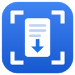
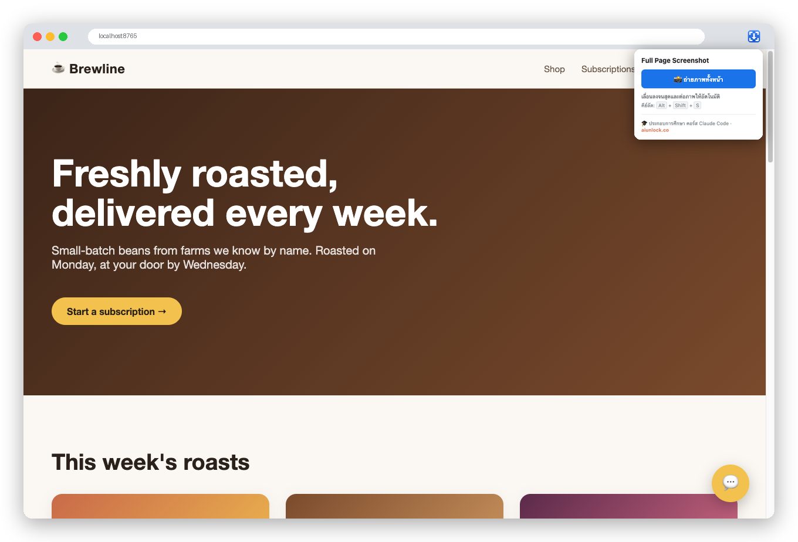
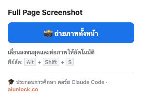
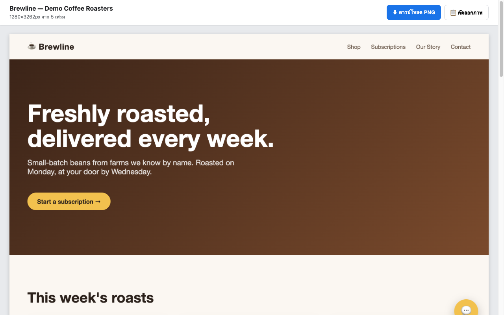
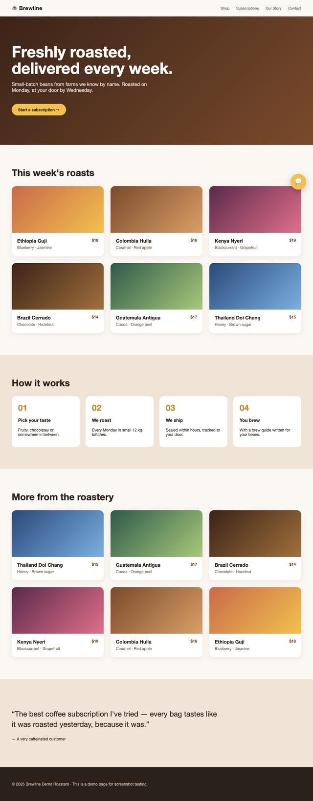

<div align="center">



# Full Page Screenshot

**Chrome extension ถ่ายภาพหน้าเว็บแบบเต็มหน้า: เลื่อนลงจนสุดแล้วต่อภาพให้อัตโนมัติ**

Manifest V3 · ไม่มี dependency · ไม่ส่งข้อมูลออกนอกเครื่อง

[](https://aiunlock.co)

🎓 โปรเจกต์ประกอบการศึกษา **คอร์ส Claude Code** โดย [aiunlock.co](https://aiunlock.co)

</div>

<p align="center">
  
</p>

## ✨ ทำอะไรได้บ้าง

- 📸 **ถ่ายทั้งหน้าในคลิกเดียว**: เลื่อนหน้าลงจนสุดและต่อภาพเป็นไฟล์ PNG ไฟล์เดียว
- 🧲 **ไม่ซ้ำ ไม่เพี้ยน**: header ที่ติดด้านบน (sticky) และปุ่มที่ลอยอยู่ (fixed) เช่นปุ่มแชท จะขึ้นในภาพแค่ครั้งเดียว ไม่ซ้ำทุกช่วง
- 🖼️ **โหลดรูปให้ครบก่อนถ่าย**: เลื่อนหน้าหนึ่งรอบก่อน ให้รูปที่โหลดทีหลัง (lazy-load) ขึ้นครบ
- 🔍 **คมเท่าจอจริง**: ใช้ความละเอียดของจอ จอ Retina ก็ไม่แตก
- ✂️ **หน้ายาวมากก็ได้**: ถ้ายาวเกินที่ Chrome วาดได้ในภาพเดียว (ราว 32,000px) จะแบ่งเป็นหลายไฟล์ให้
- ⬇️ **ดาวน์โหลดหรือคัดลอก**: บันทึกเป็น PNG หรือคัดลอกภาพไปวางใน Slack, Figma, เอกสารได้เลย
- ⌨️ **คีย์ลัด** `Alt` + `Shift` + `S`
- 🔒 **ขอสิทธิ์น้อยที่สุด**: ใช้แค่ `activeTab` กับ `scripting` ไม่ใช้ debugger และไม่มีแถบเตือนสีเหลือง

## 📷 ภาพตัวอย่าง

| Popup | หน้าผลลัพธ์ |
| :---: | :---: |
|  |  |

<details>
<summary><b>ดูภาพที่ได้ (ทั้งหน้า 1280×3262px ต่อจาก 5 ช่วงหน้าจอ)</b></summary>
<br />
<p align="center"></p>

สังเกตว่าแถบเมนูด้านบนและปุ่มแชทสีเหลืองขึ้นแค่ครั้งเดียว ไม่ซ้ำในทุกช่วง
</details>

## 🚀 ติดตั้ง

1. ดาวน์โหลดโค้ด

   ```bash
   git clone https://github.com/aiunlocked1412/full-page-screenshot-extension.git
   ```

   หรือกด **Code → Download ZIP** แล้วแตกไฟล์

2. เปิด `chrome://extensions`
3. เปิด **Developer mode** ที่มุมขวาบน
4. กด **Load unpacked** แล้วเลือกโฟลเดอร์ที่ดาวน์โหลดมา
5. (แนะนำ) กดรูปหมุด 📌 ที่เมนู extension เพื่อให้ไอคอนอยู่บนแถบเครื่องมือ

ใช้ได้กับ Chrome, Edge, Brave, Arc และเบราว์เซอร์อื่นที่ใช้ Chromium

## 🕹️ วิธีใช้

1. เปิดหน้าเว็บที่ต้องการ
2. กดไอคอน extension แล้วกด **📸 ถ่ายภาพทั้งหน้า** หรือกด `Alt` + `Shift` + `S`
3. ระหว่างถ่าย ไอคอนจะขึ้นตัวเลขบอกว่าไปถึงกี่ % แล้ว ช่วงนี้อย่าเพิ่งเลื่อนหน้าหรือสลับแท็บ
4. ถ่ายเสร็จจะเปิดแท็บใหม่ ให้กด **ดาวน์โหลด PNG** หรือ **คัดลอกภาพ**

> เปลี่ยนคีย์ลัดได้ที่ `chrome://extensions/shortcuts`

## ⚙️ หลักการทำงาน

```
popup / คีย์ลัด
      │
      ▼
background.js (service worker)
  1. เตรียมหน้า: ซ่อน scrollbar, ปิด smooth scroll, หยุด sticky ไม่ให้ติดจอ
  2. เลื่อนลงจนสุดหนึ่งรอบให้ lazy-load ทำงาน แล้ววัดความสูงทั้งหน้า
  3. เลื่อนทีละหนึ่งหน้าจอ → captureVisibleTab (เว้นช่วง ~0.55 วินาทีตามที่ Chrome จำกัด)
     หลังเฟรมแรกจะซ่อน element ที่เป็น position: fixed
  4. คืนหน้าเว็บกลับเหมือนเดิม และเลื่อนกลับไปตำแหน่งเดิม
      │
      ▼
result.html / result.js
  ดึงเฟรมทีละเฟรม → วาดต่อกันบน <canvas> → แบ่งไฟล์ถ้ายาวเกิน → PNG
```

ภาพทั้งหมดอยู่ในหน่วยความจำของเบราว์เซอร์เท่านั้น ไม่มีการส่งข้อมูลออกนอกเครื่อง อ่านรายละเอียดได้ที่ [Privacy Policy](PRIVACY.md)

## 📁 โครงสร้างไฟล์

```
├── manifest.json        # Manifest V3, สิทธิ์ activeTab + scripting, คีย์ลัด
├── background.js        # เลื่อนหน้า ถ่ายทีละเฟรม และจัดการข้อความ
├── popup.html/css/js    # ปุ่มถ่ายภาพ
├── result.html/css/js   # ต่อภาพ, preview, ดาวน์โหลด, คัดลอก
├── icons/               # ไอคอน 16/32/48/128px
├── scripts/make_icons.py# สคริปต์วาดไอคอน (Pillow)
└── docs/screenshots/    # ภาพประกอบ README
```

## ⚠️ ข้อจำกัด

- ถ่ายได้เฉพาะหน้าที่เลื่อนทั้งหน้าต่าง ถ้าเว็บเลื่อนแค่กล่องด้านใน (เช่นเว็บแอปบางตัว) จะได้แค่ส่วนที่เห็นบนจอ
- ถ่ายหน้า `chrome://`, หน้า extension อื่น และ Chrome Web Store ไม่ได้ เพราะ Chrome ห้ามไว้
- ถ้าจะถ่ายไฟล์ในเครื่อง (`file://`) ต้องเปิด **Allow access to file URLs** ในหน้ารายละเอียดของ extension
- เว็บที่เลื่อนแล้วโหลดเนื้อหาเพิ่มไม่สิ้นสุด จะถ่ายได้สูงสุด 80 ช่วงหน้าจอ แก้ได้ที่ `MAX_FRAMES` ใน `background.js`
- ภาพเคลื่อนไหวหรือวิดีโอในหน้าอาจไม่ต่อเนื่องระหว่างรอยต่อ

## 📦 แพ็กไฟล์สำหรับ Chrome Web Store

```bash
./scripts/package.sh
```

จะได้ไฟล์ `dist/full-page-screenshot-v<version>.zip` ที่มีเฉพาะไฟล์ที่ extension ใช้งานจริง นำไปอัปโหลดที่ [Chrome Web Store Developer Dashboard](https://chrome.google.com/webstore/devconsole) ได้เลย ถ้าจะอัปเดตเวอร์ชัน ให้แก้ `version` ใน `manifest.json` ก่อนแพ็ก

ช่อง **Privacy policy URL** ในหน้า Dashboard ใช้ลิงก์นี้ได้เลย:
`https://github.com/aiunlocked1412/full-page-screenshot-extension/blob/main/PRIVACY.md`

## 🎨 สร้างไอคอนใหม่

```bash
pip install pillow
python3 scripts/make_icons.py icons
```

## 🙏 เครดิต

โปรเจกต์นี้จัดทำขึ้นเพื่อ **ประกอบการศึกษา คอร์ส Claude Code** ของ **[aiunlock.co](https://aiunlock.co)**
เป็นตัวอย่างการใช้ Claude Code สร้าง Chrome extension ตั้งแต่เขียนโค้ด ทดสอบ ทำไอคอน ทำสกรีนชอท ไปจนถึงขึ้น GitHub

ถ้าอยากเรียนรู้การใช้ Claude Code ทำโปรเจกต์แบบนี้ ดูรายละเอียดคอร์สได้ที่ 👉 **[aiunlock.co](https://aiunlock.co)**

## 📄 License

[MIT](LICENSE)
